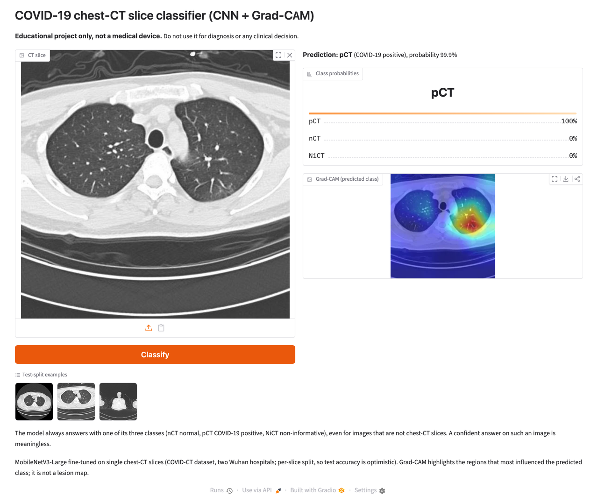
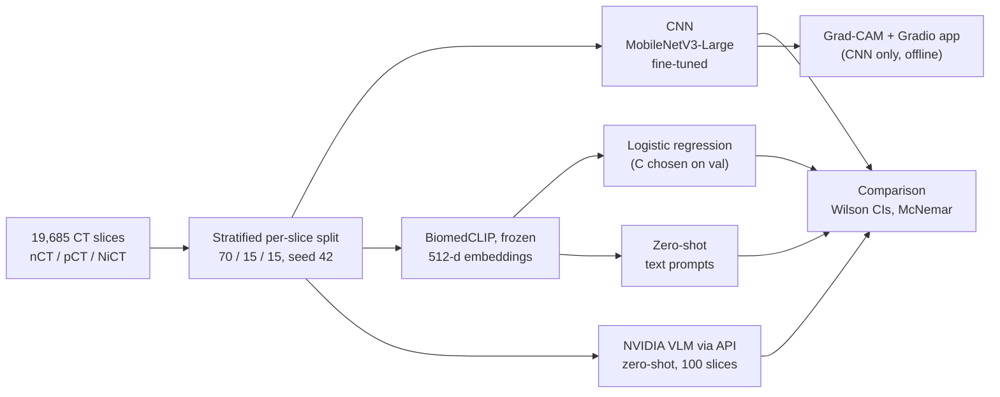

# COVID-19 chest-CT slice classifier: CNN vs. foundation models

> **Educational project only, not a medical device.** Do not use it for diagnosis or any
> clinical decision.

A PyTorch classifier that sorts single chest-CT slices into three classes: **nCT**
(normal), **pCT** (COVID-19 positive) and **NiCT** (non-informative: no usable lung
tissue). It recreates the MobileNetV3-Large approach of
[chrispathway/covid-ct-classifier](https://github.com/chrispathway/covid-ct-classifier)
and adds four things:

- **Grad-CAM** heatmaps showing which image regions drove each prediction.
- A **frozen foundation-model baseline**: BiomedCLIP image embeddings with a
  logistic-regression head trained on the same split, plus BiomedCLIP zero-shot.
- A **zero-shot benchmark** against a hosted NVIDIA vision-language model (VLM).
- A **local Gradio app** that runs offline, with no API key.

Every number below comes from a command that was actually run. The commands and their
output are in [VERIFICATION.md](VERIFICATION.md).



## Results

Four models, scored on held-out test slices. Brackets are Wilson 95% confidence intervals.

| Model | Trained on our data? | Accuracy, 100-slice benchmark | Accuracy, full test (n = 2,956) | Macro-F1, full test |
|---|---|---|---|---|
| **CNN** (MobileNetV3-Large, fine-tuned) | yes | **100.0%** [96.3, 100.0] | **99.2%** [98.8, 99.5] | **0.992** |
| BiomedCLIP, frozen + logistic regression | head only | 95.0% [88.8, 97.8] | 97.5% [96.9, 98.0] | 0.972 |
| BiomedCLIP, zero-shot (text prompts) | no | 80.0% [71.1, 86.7] | 85.9% [84.6, 87.1] | 0.854 |
| NVIDIA VLM, zero-shot (`nemotron-3.5-super-vl-120b-a12b`) | no | 65.0% [55.3, 73.6] | not run | – |

The 100-slice benchmark is a stratified sample of the test split (34 nCT, 33 pCT, 33 NiCT,
seed 42). All four models were scored on exactly these slices. The VLM was called through
the API on these 100 slices only.

What the numbers say:

- **The task-specific CNN is the best model.** On the full test split it beats the frozen
  BiomedCLIP probe, and the gap is statistically significant. An exact McNemar test on the
  2,956 paired predictions finds 65 slices only the CNN got right and 14 only the probe got
  right (p = 5.2 × 10⁻⁹).
- **A frozen foundation model gets close with almost no training.** A logistic regression on
  BiomedCLIP embeddings reaches 97.5%, against a 50.7% majority-class baseline.
- **Zero-shot is not enough for this task.** The general NVIDIA VLM misses most COVID-19
  slices: its pCT recall is 33.3% (11/33). 12 of its 100 answers could not be parsed and
  count as wrong. The medical BiomedCLIP zero-shot does better (85.9%) but stays far below
  the trained models.
- **Duplicates do not explain the CNN's score.** 15 test slices are byte-identical to a
  training slice. Without them the CNN scores 99.22% and the probe 97.48% (n = 2,941).

Per-class recall on the full test split:

| Model | nCT | pCT | NiCT |
|---|---|---|---|
| CNN | 99.3% | 99.3% | 98.9% |
| BiomedCLIP + logistic regression | 98.9% | 95.2% | 96.7% |
| BiomedCLIP zero-shot | 82.8% | 78.0% | 96.6% |

The original repository reports 99.76% test accuracy after 25 epochs. That figure is a
reference only: it comes from a different training run, and this project trained for 15
epochs.
Full results are in [outputs/results/comparison.md](outputs/results/comparison.md) and
[outputs/results/metrics.json](outputs/results/metrics.json).

### CV bullet

- Built a COVID-19 chest-CT slice classifier (PyTorch, MobileNetV3-Large) that reaches
  99.2% test accuracy (95% CI 98.8–99.5%, macro-F1 0.992) on 2,956 held-out slices, and
  benchmarked it against a frozen BiomedCLIP probe (97.5%) and a zero-shot NVIDIA VLM (65%
  on 100 slices); shipped with Grad-CAM explanations, a local Gradio app and 80 tests
  (95% core-logic coverage).

## How it works



1. **Data.** 19,685 original CT slices: 9,979 nCT, 4,001 pCT and 5,705 NiCT. The data check
   found no unreadable files and no duplicates across classes. The slices are split per
   class with seed 42 into 13,778 train, 2,951 validation and 2,956 test slices, the same
   sizes as the original repository.
2. **CNN.** MobileNetV3-Large with ImageNet weights and a new 960 → 1280 → 3 head.
   Training used AdamW (learning rate 1e-4, weight decay 1e-4), batch size 16, random
   resized crops and horizontal flips. It ran for 15 epochs on an M1 MacBook Air (MPS),
   about 74 minutes in total. The kept checkpoint is epoch 10, which had the best
   validation macro-F1 (0.9935).
3. **Frozen encoder + head.** BiomedCLIP (ViT-B/16, via open_clip) turns every slice into a
   512-d embedding. Extraction took about 19 minutes on MPS, and the cache is resumable.
   A multinomial logistic regression is trained on the L2-normalised train embeddings.
   C and class weighting are chosen on validation macro-F1 only (C = 10, no weighting), and
   the test split is scored once. The encoder is a parameter, so another one can be
   swapped in.
4. **Zero-shot.** For BiomedCLIP, the class with the most similar text prompt wins. Three
   prompt sets were written in advance, and the best one was chosen on validation. The
   NVIDIA VLM receives each slice with a single fixed prompt. Requests are rate-limited,
   retried on errors and cached on disk.
5. **Comparison.** Accuracy, macro-F1, per-class precision, recall and F1, and confusion
   matrices, with Wilson 95% intervals. An exact McNemar test compares the CNN and the
   probe. CNN and VLM numbers are read from their result files, never retyped, and a
   `--check` command verifies that the comparison matches its sources.
6. **Explanations and UI.** Grad-CAM is computed on the last convolutional block. The
   Gradio app shows the predicted class, the three probabilities and the overlay. It binds
   to 127.0.0.1 only and needs neither a network connection nor an API key.

## Setup and run

Requirements: Python 3.11. Tested on macOS with an Apple M1 (the GPU is used through MPS
when available, otherwise the CPU).

```bash
python3.11 -m venv .venv && source .venv/bin/activate
pip install -r requirements.txt && pip install -e .
```

**Run the app** (needs only the committed checkpoint, no dataset and no key):

```bash
python app/app.py          # then open http://127.0.0.1:7860
```

**Dataset** (needed for training, evaluation and the benchmarks). Download
[`azaemon/preprocessed-ct-scans-for-covid19`](https://www.kaggle.com/datasets/azaemon/preprocessed-ct-scans-for-covid19)
from Kaggle and extract it so that the original images are in
`archive/Original CT Scans/{nCT,pCT,NiCT}/`. Alternatively, point `CTCLF_DATA_ROOT` to that
folder. Only the original images are used, not the preprocessed ones.

| Task | Command |
|---|---|
| Check the data, write split sizes | `python -m ctclf.data` |
| Train (resumable) | `python -m ctclf.train --epochs 15` (add `--resume` to continue) |
| Evaluate the checkpoint | `python -m ctclf.evaluate` |
| Predict one slice | `python -m ctclf.predict path/to/slice.jpg` |
| Grad-CAM overlay | `python -m ctclf.gradcam path/to/slice.jpg --out overlay.png` |
| Extract BiomedCLIP embeddings | `python -m ctclf.embeddings` (downloads about 784 MB of weights on first use) |
| Probe, zero-shot and comparison | `python -m ctclf.probe` (`--check` re-verifies the files) |
| NVIDIA VLM benchmark | `python -m ctclf.benchmark_vlm` (`--check` re-verifies the summary) |
| Tests with coverage | `pytest --cov=src/ctclf --cov=app` |
| Lint and format | `ruff format . && ruff check .` |

The NVIDIA benchmark is the only part that needs a key. Copy `.env.example` to `.env` and
add a free key from [build.nvidia.com](https://build.nvidia.com). Its responses are cached
in `outputs/results/vlm_cache/`, so the committed results can be re-checked without a key.

## Repository structure

```
app/
  app.py               Gradio UI (CNN + Grad-CAM, localhost only)
  smoke_check.py       calls a running app through gradio_client
src/ctclf/
  config.py            paths, class order, hyperparameters, device
  data.py              index, stratified split, transforms, data checks
  model.py             MobileNetV3-Large with the 3-class head
  train.py             training loop, per-epoch checkpoints, resume
  evaluate.py          metrics, plots, majority baseline
  predict.py           single-image inference
  gradcam.py           Grad-CAM heatmaps and overlays
  embeddings.py        frozen-encoder embeddings, resumable cache
  probe.py             logistic-regression probe, zero-shot, McNemar, comparison
  nvidia_client.py     rate-limited, cached client for the NVIDIA API
  discover_vlm.py      finds which hosted models accept images
  benchmark_vlm.py     CNN vs. VLM benchmark on 100 test slices
tests/                 pytest suite (no dataset, network or model download needed)
outputs/
  checkpoints/best.pth CNN weights (16 MB)
  results/             metrics, plots, benchmark and comparison files, VLM cache
assets/                Grad-CAM examples, example slices, app screenshot
VERIFICATION.md        commands run and their real output
```

## Limitations

- **The test accuracy is optimistic.** The dataset has no patient identifiers, so the split
  is per slice. Neighbouring slices of the same patient can end up in both train and test,
  and that inflates the score by an amount that cannot be measured here.
- **One source of data.** All images come from two hospitals in Wuhan. Nothing shows the
  models work on other hospitals, scanners or protocols.
- **Single slices only.** A real CT study is a 3D volume. The project never aggregates
  slices per patient.
- **The VLM sample is small.** 100 slices give wide confidence intervals (55–74% for the
  VLM). Hosted models can also change or be withdrawn, so that result may not reproduce
  later.
- **Foundation-model results are not clinically validated**, and neither is the CNN.
- **The model always picks one of its three classes**, even for images that are not CT
  slices. In testing, a synthetic colour picture was labelled "normal" with 91.7%
  probability. The app says this next to the disclaimer.
- **Grad-CAM shows what influenced the model, not where a lesion is.**
- **Not a medical device.** This is an educational project.

## Attribution

- **Dataset:** [`azaemon/preprocessed-ct-scans-for-covid19`](https://www.kaggle.com/datasets/azaemon/preprocessed-ct-scans-for-covid19)
  (Kaggle, CC BY 4.0). The original images come from the iCTCF resource: Ning, W. et al.
  (2020), "Open resource of clinical data from patients with pneumonia for the prediction of
  COVID-19 outcomes via deep learning", *Nature Biomedical Engineering*. The three example
  slices in `assets/examples/` are taken from this dataset.
- **Original project:** [chrispathway/covid-ct-classifier](https://github.com/chrispathway/covid-ct-classifier).
- **MobileNetV3:** Howard, A. et al. (2019), "Searching for MobileNetV3", ICCV.
- **BiomedCLIP:** Zhang, S. et al. (2023), "BiomedCLIP: a multimodal biomedical foundation
  model pretrained from fifteen million scientific image-text pairs"; model
  [microsoft/BiomedCLIP-PubMedBERT_256-vit_base_patch16_224](https://huggingface.co/microsoft/BiomedCLIP-PubMedBERT_256-vit_base_patch16_224)
  (MIT licence), loaded with [open_clip](https://github.com/mlfoundations/open_clip).
- **Grad-CAM:** Selvaraju, R. R. et al. (2017), ICCV; implementation from
  [pytorch-grad-cam](https://github.com/jacobgil/pytorch-grad-cam).
- **VLM:** `nvidia/nemotron-3.5-super-vl-120b-a12b`, accessed through the NVIDIA Build API.
